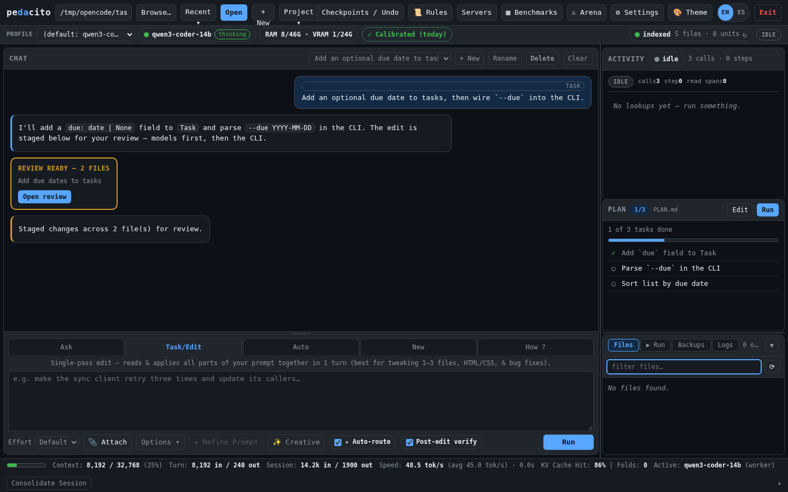
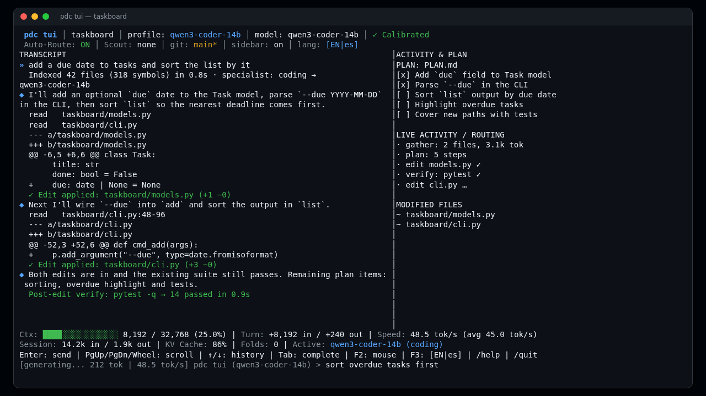

🌐 [English](README.md) | **Español**

# Pedacito

[](https://pypi.org/project/pedacito/)

[](LICENSE)


**Pedacito** (`pdc`) es un agente de programación con IA, local primero, pensado para los modelos que puedes
ejecutar en la GPU que ya tienes, de 4B a 27B parámetros. Corta tu código en piezas pequeñas y
con límites precisos, de modo que un modelo pequeño lee y edita solo las líneas que importan, en lugar de
necesitar un modelo de frontera con una ventana de 200k tokens.

- **Servidores locales e híbridos:** LM Studio, Ollama, Lemonade Server, llama.cpp, vLLM, Strata/Avalon
  y cualquier endpoint compatible con OpenAI.
- **Modelos alojados cuando quieras:** Claude, ChatGPT, DeepSeek, Qwen, Gemini y OpenRouter para planificar,
  verificar o escalar, con un tope de gasto.
- **Seguro por defecto:** escaneo de secretos, sandbox del sistema operativo y checkpoints a los que puedes volver.





## Inicio rápido en 30 segundos

```bash
pip install pedacito                 # Windows: py -m pip install pedacito
pdc gui ~/code/your-project          # browser control panel
pdc tui ~/code/your-project          # split-screen terminal
pdc ask "where is login handled?"    # one-shot CLI, from the project folder
```

Primero inicia un servidor de modelos (LM Studio, Ollama, Lemonade o llama.cpp). Luego, en la GUI abre
**Settings → Model discovery → Scan local servers**, o ejecuta `pdc models scan`.

> [!TIP]
> ¿Prefieres español? Usa el selector `EN | ES` en la barra superior de la GUI, presiona `F3` en la TUI o ejecuta
> `pdc --lang es gui`. Consulta [Idioma y localización](docs/es/CONFIG.md#idioma-y-localización-language-llm_reply_language).

## Novedades de la v0.3.1

| Función | Qué obtienes | Más información |
|---|---|---|
| **GUI, TUI y documentación bilingües EN / ES** | Cambia la GUI con el selector EN/ES de la barra superior, la TUI con `F3` o `/lang`, y la CLI con `--lang es` o `PEDACITO_LANG`. `llm_reply_language` controla el idioma de las explicaciones del modelo. Cada guía tiene una edición en español. | [Idioma y localización](docs/es/CONFIG.md#idioma-y-localización-language-llm_reply_language) |
| **Perfilado avanzado del sistema y auto-ajuste** | `pedacito profile` muestra una instantánea de RAM/VRAM independiente del fabricante, con una fuente para cada número (sysfs de Linux, `nvidia-smi` de NVIDIA, `vm_stat` de macOS, `winapi` de Windows), una sonda de prefill/generación en caché y el ajuste del perfil activo. `auto_tune = true` (opcional) adapta el contexto, los presupuestos de recuperación y el tiempo límite a la memoria libre; si falta telemetría, se abstiene, y las configuraciones existentes no cambian. | [Perfilado del sistema y auto-ajuste](docs/es/CONFIG.md#perfilado-avanzado-del-sistema-y-auto-ajuste) |
| **Auto-actualización consciente del contexto** | Una verificación de versiones discreta y desactivable: una sola petición GET anónima a PyPI al iniciar (tiempo límite de 2 s, en caché por 24 h), un banner descartable en la GUI con actualización en streaming y Restart, `pdc update --run` y el `/update` de la TUI. El comando coincide con tu método de instalación (pipx, venv, pip --user o git para copias editables). `check_for_updates = false` mantiene Pedacito totalmente sin conexión. | [Actualización](docs/es/INSTALLATION.md#actualización) |
| **Generación local de imágenes** | `pedacito image` y `/image` en la GUI/TUI generan imágenes en un Lemonade Server local, con calibración para modelos de imagen. | [Generación local de imágenes](docs/es/USAGE.md#generación-local-de-imágenes) |
| **Entrada multimodal de imágenes** | Envía PNG/JPEG/WebP/GIF a un modelo con visión: `--image RUTA`, pegar/arrastrar/`📎 Attach` en la GUI, `/attach` en la TUI (4 imágenes, 10 MB cada una). | [Entrada multimodal](docs/es/USAGE.md#entrada-multimodal-en-el-chat) |
| **Caché de prompts nativa de Anthropic** | `anthropic_native = true` (por defecto) usa `/v1/messages` con marcadores `cache_control` explícitos, TTL `5m`/`1h`, razonamiento, herramientas e imágenes nativos. | [Caché de prompts alojada](docs/es/CONFIG.md#caché-de-prompts-alojada) |
| **Compositor multilínea en la TUI** | `Shift+Enter`, `Alt+Enter`, `Ctrl+J` o una `\` final añaden saltos de línea; el pegado entre corchetes conserva los bloques pegados. | [`tui`](docs/es/USAGE.md#tui-sesión-de-terminal-en-pantalla-dividida) |


## Novedades de la v0.3.0

| Función | Qué obtienes | Más información |
|---|---|---|
| **Administrador de VRAM entre servidores** | Trata todos tus servidores de modelos locales como un solo conjunto. Muestra qué modelos están residentes, los carga y descarga mediante la API de cada runtime, y expulsa a los demás servidores antes de una ejecución. | [Administrador del ciclo de vida de servidores](docs/es/ARCHITECTURE.md#administrador-del-ciclo-de-vida-de-servidores) |
| **Strata local-moe** | Los servidores de mezcla de expertos por niveles (Strata, Avalon) tienen su propio perfil de ejecución: presupuestos de respuesta mayores, un tiempo límite de 10 minutos y un solo stream a la vez. | [Nivel local-moe](docs/es/ARCHITECTURE.md#perfiles-de-ejecución-y-el-nivel-local-moe) |
| **Streaming SSE** | Los tokens llegan en vivo mediante server-sent events, con un panel de razonamiento en vivo, un latido por llamada y un Stop casi instantáneo. | [Telemetría en vivo](docs/es/USAGE.md#telemetría-en-vivo) |
| **Security Guard** | Busca secretos antes de cualquier petición a un servicio alojado (`sk-`, `pypi-`, `ghp_`, claves de AWS y Google, claves privadas PEM), mantiene los archivos sensibles fuera del alcance del modelo, pregunta antes de acciones riesgosas y ejecuta los comandos en un sandbox del sistema operativo. | [Guía de seguridad](docs/es/SECURITY.md) |
| **Temas personalizados** | Esquemas de color de diez tokens compartidos por la GUI y la TUI. Nueve preajustes, tus propios esquemas guardados y un anclaje por proyecto. | [Esquemas de color](docs/es/CONFIG.md#esquemas-de-color) |
| **Anclaje con `@`** | Escribe `@file.py` o `@Class.method` en un prompt para fijar ese código exacto en cada fase de la ejecución. | [Fijar contexto](docs/es/USAGE.md#fijar-contexto-con-) |
| **Árbol de checkpoints** | Cada ejecución genera un checkpoint. Inspecciona cada cambio como un diff unificado y luego vuelve atrás con `pdc undo` o `pdc checkout`. | [Checkpoints y reversión](docs/es/SECURITY.md#pilar-4-registro-de-auditoría-inmutable-y-viaje-en-el-tiempo) |
| **Enrutamiento híbrido** | Un modelo arquitecto potente planifica una tarea y un editor local rápido la implementa. En una sola GPU, el servidor del arquitecto se expulsa entre las dos etapas. | [Enrutamiento híbrido](docs/es/ARCHITECTURE.md#enrutamiento-híbrido-un-arquitecto-planifica-un-editor-implementa) |


## Documentación

| Guía | Qué cubre |
|---|---|
| [Instalación](docs/es/INSTALLATION.md) | pip, pipx, extras, servidores de modelos, servidores de inferencia en GPU, actualización |
| [Uso](docs/es/USAGE.md) | GUI, CLI, TUI, ejecuciones autónomas, anclaje con `@`, cambio de idioma |
| [Configuración](docs/es/CONFIG.md) | Archivos de configuración, reglas, temas, perfiles, idioma, cada ajuste |
| [Arquitectura](docs/es/ARCHITECTURE.md) | Motor, administrador del ciclo de vida de servidores, `local-moe`, enrutamiento híbrido, límites |
| [Skills y herramientas](docs/es/SKILLS_AND_TOOLS.md) | 19 skills incluidas, skills personalizadas, servidores MCP, hooks, sobrescritura de prompts |
| [Seguridad](docs/es/SECURITY.md) | Escaneo de credenciales, sandbox, checkpoints, reportes |
| [Contribuir](docs/es/CONTRIBUTING.md) | Entorno de desarrollo, pruebas, mapa de módulos, reglas de docs y locales |
| [QUICKSTART.es.md](QUICKSTART.es.md) | Primeras ejecuciones paso a paso con la salida esperada |
| [MODEL_GUIDE.es.md](MODEL_GUIDE.es.md) | Cómo elegir, combinar y ajustar modelos |
| [TECHNIQUES.es.md](TECHNIQUES.es.md) | Cómo Pedacito logra que los modelos pequeños funcionen bien |

**Propiedad de la documentación.** `docs/` (INSTALLATION, ARCHITECTURE, USAGE, CONFIG, SKILLS_AND_TOOLS, SECURITY y CONTRIBUTING) es la referencia canónica de ajustes, comandos y garantías. Las tres guías de la raíz, [QUICKSTART.es.md](QUICKSTART.es.md), [MODEL_GUIDE.es.md](MODEL_GUIDE.es.md) y [TECHNIQUES.es.md](TECHNIQUES.es.md), siguen siendo las guías canónicas orientadas a tareas: primeras ejecuciones, combinación y ajuste de modelos, y técnicas para modelos pequeños. Este README es el índice, y [CHANGELOG.md](CHANGELOG.md) es el historial. La nueva prosa de referencia va en `docs/`, los nuevos tutoriales van en las guías de la raíz, y cada conjunto enlaza al otro en lugar de copiar texto.

Ejecuta `pdc --help` para ver todos los comandos, o `pdc how "tu pregunta"` para la ayuda integrada.

## Contribuir

Los issues y pull requests son bienvenidos; por favor abre un issue antes de un PR grande. Consulta
[docs/es/CONTRIBUTING.md](docs/es/CONTRIBUTING.md). El sitio web del proyecto es
[pedacito.dev](https://www.pedacito.dev), y puedes contactar al mantenedor en
contact@pedacito.dev. Reporta los problemas de seguridad de forma privada, como se describe en
[docs/es/SECURITY.md](docs/es/SECURITY.md#reportar-una-vulnerabilidad).

## Licencia

MIT, consulta [LICENSE](LICENSE).
