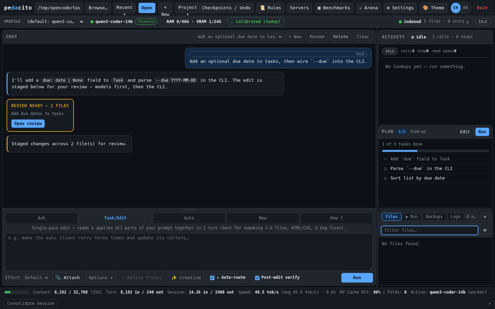
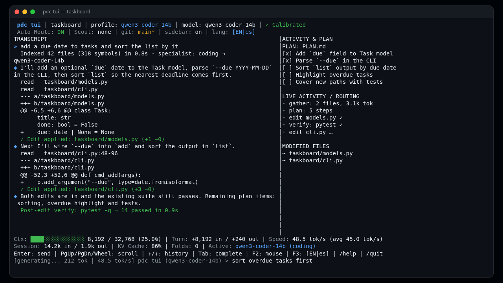

🌐 **English** | [Español](README.es.md)

# Pedacito

[](https://pypi.org/project/pedacito/)

[](LICENSE)


**Pedacito** (`pdc`) is a local-first AI coding agent for the models you can run on the GPU you
already own, from 4B to 27B parameters. It cuts your codebase into small, precisely bounded
pieces, so a small model reads and edits only the lines that matter, instead of needing a
frontier model with a 200k-token window.

- **Local and hybrid servers:** LM Studio, Ollama, Lemonade Server, llama.cpp, vLLM, Strata/Avalon,
  and any OpenAI-compatible endpoint.
- **Hosted when you want it:** Claude, ChatGPT, DeepSeek, Qwen, Gemini and OpenRouter for planning,
  verification or escalation, with a spend cap.
- **Safe by default:** secret scanning, OS sandbox, checkpoints you can roll back.





## 30-second quickstart

```bash
pip install pedacito                 # Windows: py -m pip install pedacito
pdc gui ~/code/your-project          # browser control panel
pdc tui ~/code/your-project          # split-screen terminal
pdc ask "where is login handled?"    # one-shot CLI, from the project folder
```

Start a model server first (LM Studio, Ollama, Lemonade or llama.cpp), then in the GUI open
**Settings → Model discovery → Scan local servers**, or run `pdc models scan`.

> [!TIP]
> Prefer Spanish? Use the `EN | ES` switcher in the GUI top bar, press `F3` in the TUI, or run
> `pdc --lang es gui`. See [Language & localization](docs/CONFIG.md#language--localization-language-llm_reply_language).

## What's new in v0.3.1

| Feature | What you get | Read more |
|---|---|---|
| **Bilingual EN / ES UI, TUI & docs** | Switch the GUI with the EN/ES top-bar toggle, the TUI with `F3` or `/lang`, the CLI with `--lang es` or `PEDACITO_LANG`. `llm_reply_language` controls the language of the model's explanations. Every guide has a Spanish edition. | [Language & localization](docs/CONFIG.md#language--localization-language-llm_reply_language) |
| **Advanced system profiling & auto-tune** | `pedacito profile` shows a vendor-neutral RAM/VRAM snapshot with a source per number (Linux sysfs, NVIDIA `nvidia-smi`, macOS `vm_stat`, Windows `winapi`), a cached prefill/generation probe and the active profile's tuning. `auto_tune = true` (opt-in) fits context, retrieval budgets and timeout to free memory; missing telemetry makes it abstain, and existing configs do not change. | [System profiling and auto-tune](docs/CONFIG.md#advanced-system-profiling-and-auto-tune) |
| **Context-aware auto-update** | A quiet, opt-out release check: one anonymous PyPI GET at startup (2 s timeout, cached 24 h), a dismissible GUI banner with a streamed upgrade and Restart, `pdc update --run`, and the TUI `/update`. The command matches your install method (pipx, venv, pip --user, or git for editable checkouts). `check_for_updates = false` keeps Pedacito fully offline. | [Upgrading](docs/INSTALLATION.md#upgrading) |


## What's new in v0.3.0

| Feature | What you get | Read more |
|---|---|---|
| **Cross-server VRAM manager** | Treats all your local model servers as one pool. It shows which models are resident, loads and unloads them through each runtime's API, and evicts other servers before a run. | [Server lifecycle manager](docs/ARCHITECTURE.md#server-lifecycle-manager) |
| **Strata local-moe** | Tiered mixture-of-experts servers (Strata, Avalon) get their own execution profile: larger reply budgets, a 10-minute timeout and one stream at a time. | [local-moe tier](docs/ARCHITECTURE.md#execution-profiles-and-the-local-moe-tier) |
| **SSE streaming** | Tokens stream live over server-sent events, with a live reasoning drawer, a per-call heartbeat and a near-instant Stop. | [Live telemetry](docs/USAGE.md#live-telemetry) |
| **Security Guard** | Scans for secrets before any hosted request (`sk-`, `pypi-`, `ghp_`, AWS and Google keys, PEM private keys), keeps sensitive files out of the model's reach, asks before risky actions, and runs commands in an OS sandbox. | [Security guide](docs/SECURITY.md) |
| **Custom themes** | Ten-token color schemes shared by the GUI and the TUI. Nine presets, your own saved schemes, and a per-project pin. | [Color schemes](docs/CONFIG.md#color-schemes) |
| **`@` pinning** | Write `@file.py` or `@Class.method` in a prompt to pin that exact code into every phase of the run. | [Pinning context](docs/USAGE.md#pinning-context-with-) |
| **Checkpoint tree** | Every run is checkpointed. Inspect each change as a unified diff, then roll back with `pdc undo` or `pdc checkout`. | [Checkpoints and rollback](docs/SECURITY.md#pillar-4-immutable-audit-trail-and-time-travel) |
| **Hybrid routing** | A strong architect model plans a task and a fast local editor implements it. On one GPU, the architect's server is evicted between the two stages. | [Hybrid routing](docs/ARCHITECTURE.md#hybrid-routing-an-architect-plans-an-editor-implements) |


## Documentation

| Guide | What it covers |
|---|---|
| [Installation](docs/INSTALLATION.md) | pip, pipx, extras, model servers, GPU inference servers, upgrading |
| [Usage](docs/USAGE.md) | GUI, CLI, TUI, autonomous runs, `@` pinning, language switching |
| [Configuration](docs/CONFIG.md) | Config files, rules, themes, profiles, language, every setting |
| [Architecture](docs/ARCHITECTURE.md) | Engine, server lifecycle manager, `local-moe`, hybrid routing, limits |
| [Skills and tools](docs/SKILLS_AND_TOOLS.md) | 19 bundled skills, custom skills, MCP servers, hooks, prompt overrides |
| [Security](docs/SECURITY.md) | Credential scanning, sandboxing, checkpoints, reporting |
| [Contributing](docs/CONTRIBUTING.md) | Dev setup, tests, module map, docs and locale rules |
| [QUICKSTART.md](QUICKSTART.md) | Step-by-step first runs with expected output |
| [MODEL_GUIDE.md](MODEL_GUIDE.md) | Choosing, pairing and tuning models |
| [TECHNIQUES.md](TECHNIQUES.md) | How Pedacito gets small models to work well |

**Docs ownership.** `docs/` (INSTALLATION, ARCHITECTURE, USAGE, CONFIG, SKILLS_AND_TOOLS, SECURITY and CONTRIBUTING) is the canonical reference for settings, commands and guarantees. The three root guides, [QUICKSTART.md](QUICKSTART.md), [MODEL_GUIDE.md](MODEL_GUIDE.md) and [TECHNIQUES.md](TECHNIQUES.md), remain the canonical task-oriented guides: first runs, model pairing and tuning, and small-model techniques. This README is the index, and [CHANGELOG.md](CHANGELOG.md) is the history. New reference prose goes to `docs/`, new walkthroughs go to the root guides, and each set links to the other instead of copying text.

Run `pdc --help` for every command, or `pdc how "your question"` for built-in help.

## Contributing

Issues and pull requests are welcome; please open an issue before a large PR. See
[docs/CONTRIBUTING.md](docs/CONTRIBUTING.md). The project website is
[pedacito.dev](https://www.pedacito.dev), and the maintainer can be reached at
contact@pedacito.dev. Report security issues privately, as described in
[docs/SECURITY.md](docs/SECURITY.md#reporting-a-vulnerability).

## License

MIT, see [LICENSE](LICENSE).
